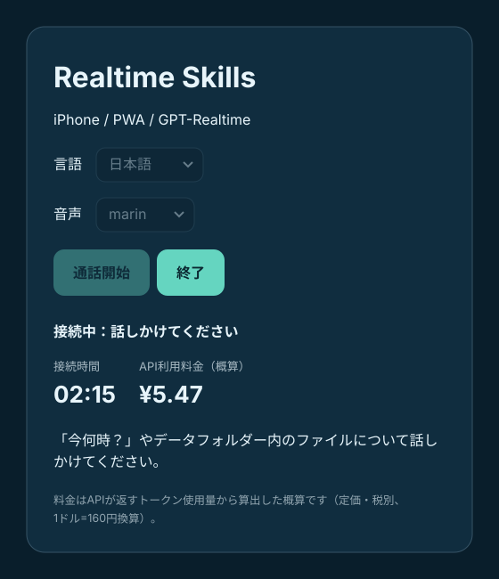

# Realtime Skills PWA - 最小構成のデモ

Docker コンテナ 1 つ、Node.js バックエンドプロセス 1 つ、GPT-Realtime エージェント 1 つで構成されています。PWA は WebRTC で OpenAI と通信し、SDK の function tool が Node バックエンドを呼び出して、許可リストに登録されたスキルを実行します。これは SDK が任意の Agent Skills を自動実行する仕組みでは**ありません**。`AGENTS.md` と `SKILL.md` は指示として読み込まれ、各スキルは個別に実装されたツールが実行します。

サンプルのエージェントは、架空のピザ店「コメットピザ」の電話注文係として動作します。OpenAI と Azure OpenAI に対応し、英語/日本語の画面切り替えと音声の選択ができ、接続時間と API 利用料金の概算を表示します。

## 画面

<p>
  
</p>

## 起動

```sh
cp .env.example .env
# .env を編集して OPENAI_API_KEY（または Azure OpenAI の設定）を設定
docker compose up --build -d
```

### wslc（WSL Container CLI）で起動

Windows では、Docker の代わりに `wslc` でビルド・起動することもできます。`wslc` は `docker-compose.yaml` を読み込まないため、同等のオプションを直接指定します（PowerShell）。

```powershell
Copy-Item .env.example .env
# .env を編集して OPENAI_API_KEY（または Azure OpenAI の設定）を設定
wslc build -t realtime-skills-pwa .
wslc run -d --name realtime-skills --env-file .env -p 127.0.0.1:3000:3000 -v "${PWD}\data:/data:ro" realtime-skills-pwa
```

ログの確認・停止・削除:

```powershell
wslc logs realtime-skills
wslc stop realtime-skills
wslc remove realtime-skills
```

`wslc run` には再起動ポリシーのオプションがないため、Compose（`restart: unless-stopped`）と異なりコンテナーは自動で再起動されません。再度起動するには `wslc start realtime-skills` を実行してください。

Compose のポートは 127.0.0.1:3000 にバインドされます。iPhone から使う場合は、アクセス制御を備えた既存の **HTTPS リバースプロキシ** 経由で公開してください。Safari で HTTPS の URL を開き、マイクへのアクセスを許可し、言語と音声を選んでから `通話開始` をタップします。エージェントがコメットピザの店員として応対するので、注文をしてみたり、「今何時？」と聞いてみたりしてください。PWA として使うには、Safari の共有 > ホーム画面に追加 を選びます。

## データフォルダー

ホストの `data/` フォルダーは、コンテナー内の `/data`（`DATA_DIR`）に読み取り専用でマウントされます。エージェントは `data-list`・`data-search`・`data-read` スキル（`skills/data-files/SKILL.md`）を使って、そこにある `.md`・`.txt`・`.csv`・`.json` ファイルの一覧取得・検索・読み込みを行えます。「カフェの土曜日の営業時間は？」「サーモスタットのE3エラーの対処法は？」などと聞いてみてください。

`data/` 内のサンプルファイルは、このプロジェクト用に作成した架空のコンテンツで、パブリックドメイン（CC0 1.0）として提供しています。自分のファイルに置き換えて使ってください。イメージには `data/` を含めていないため、ファイルを変更してもリビルドは不要です。データフォルダー外のパスは拒否されます。

## ディレクトリ構成

- `src/main.js`: ブラウザ側の RealtimeAgent / WebRTC、`run_skill` ツール、言語・音声の選択、接続時間と料金の表示
- `server.js`: 単一の Express バックエンド。OpenAI / Azure OpenAI のエフェメラルトークン、設定と料金単価、許可リスト方式のスキルハンドラー、データフォルダーへのアクセス、静的ファイル配信
- `AGENTS.md`: エージェント全体への指示
- `skills/current-time/SKILL.md`: 現在時刻スキル
- `skills/data-files/SKILL.md`: データフォルダーの一覧・検索・読み込みスキル
- `skills/comet-pizza-order/SKILL.md`: コメットピザの電話注文スキル
- `data/`: エージェントが参照するコンテンツ（サンプル: `comet-pizza-menu.md` ほか架空のファイル）
- `images/`: 画面モック（英語・日本語）
- `architecture.svg`: アーキテクチャ図
- `BASIC_SPEC.md`: 要件
- `BASIC_DESIGN.md`: 設計

## セキュリティ / 制約

**デモ専用です。このままの状態でパブリックなインターネットに公開しないでください。** 認証、レート制限、ユーザーごとのツール認可、必要に応じた CSRF 対策、監査ログを追加してください。ブラウザからのツール呼び出しはセキュリティ境界になりません。`OPENAI_API_KEY` や `AZURE_OPENAI_API_KEY` を決してブラウザに公開しないでください。一時的なクライアントシークレットは有効期間が短いものの、それでも保護する必要があります。API とスキルのエンドポイントはリバースプロキシで制限してください。`SKILL.md` から任意のシェルコマンドを実行しないでください。

スキルは、固定の許可リストに登録したハンドラー（`current-time`、`data-list`、`data-search`、`data-read`）と、指示文だけのスキルで構成されており、任意のスキルスクリプトを自動で検出・実行するものではありません。注文の合計金額はモデルが計算しており、注文はどこにも送信されません。デモを最小限に保つため、PWA マニフェストにはインストール用アイコンを意図的に含めていません。きちんとしたインストール体験にするにはアイコンを追加してください。iOS では、バックグラウンドに移行したり画面がロックされたりすると音声が停止することがあります。セッションの有効期限切れや切断の後は再接続してください。この例は、この環境では OpenAI API キーを使ったエンドツーエンドの検証を行っていません。

## 参考

- https://openai.github.io/openai-agents-js/ja/guides/voice-agents/quickstart/
- https://openai.github.io/openai-agents-js/guides/voice-agents/transport/

## モデルについて
幅広い互換性のため、既定のモデルは `gpt-realtime` です。別のモデル（例: `gpt-realtime-2.1`、`gpt-realtime-2.1-mini`）を使う場合は `REALTIME_MODEL` を、Azure OpenAI の場合はデプロイ名を設定してください。ブラウザはサーバーから受け取った値を使います。画面の料金は OpenAI の定価に基づく概算です。Azure のデプロイ名がモデル名と異なる場合は `REALTIME_PRICING_MODEL` を設定してください。
