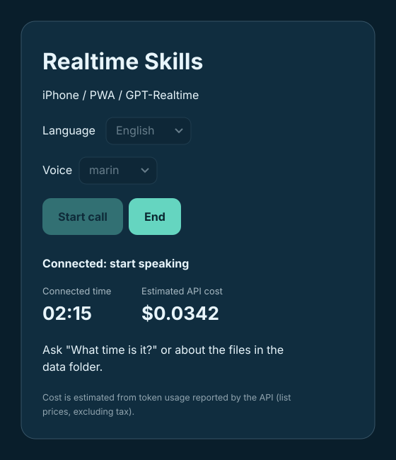

# Realtime Skills PWA - minimal demonstration

One Docker container, one Node.js backend process, one GPT-Realtime agent. The PWA uses WebRTC to communicate with OpenAI; its SDK function tool calls the Node backend to run an allowlisted skill. This is **not** the SDK automatically executing arbitrary Agent Skills; `AGENTS.md` and `SKILL.md` are loaded as instructions, and a separately coded tool executes each skill.

The sample agent works as the phone order staff of the fictional "Comet Pizza". It supports OpenAI and Azure OpenAI, an English/Japanese UI with voice selection, and shows the connected time and estimated API cost.

## Screen

<p>
  
</p>

## Start

```sh
cp .env.example .env
# Edit .env and set OPENAI_API_KEY (or the Azure OpenAI settings)
docker compose up --build -d
```

### Start with wslc (WSL Container CLI)

On Windows, you can build and run the container with `wslc` instead of Docker. `wslc` does not read `docker-compose.yaml`, so pass the equivalent options explicitly (PowerShell):

```powershell
Copy-Item .env.example .env
# Edit .env and set OPENAI_API_KEY (or the Azure OpenAI settings)
wslc build -t realtime-skills-pwa .
wslc run -d --name realtime-skills --env-file .env -p 127.0.0.1:3000:3000 -v "${PWD}\data:/data:ro" realtime-skills-pwa
```

Check logs, stop, and remove:

```powershell
wslc logs realtime-skills
wslc stop realtime-skills
wslc remove realtime-skills
```

`wslc run` has no restart policy option, so unlike Compose (`restart: unless-stopped`) the container is not restarted automatically. Run `wslc start realtime-skills` to start it again.

The Compose port is bound to 127.0.0.1:3000. For iPhone, publish it through your existing **HTTPS reverse proxy** with access control; open the HTTPS URL in Safari, allow microphone access, choose the language and voice, then tap `Start call`. The agent answers as Comet Pizza staff, so try placing an order, or ask "What time is it?". Use Safari Share > Add to Home Screen for PWA.

## Data folder

The host `data/` folder is mounted read-only at `/data` in the container (`DATA_DIR`). The agent can list, search, and read `.md`, `.txt`, `.csv`, and `.json` files there through the `data-list`, `data-search`, and `data-read` skills (`skills/data-files/SKILL.md`). Try asking "カフェの土曜日の営業時間は？" or "サーモスタットのE3エラーの対処法は？".

The sample files in `data/` are fictional content written for this project and released into the public domain (CC0 1.0). Replace them with your own files; the image does not include `data/`, so changes take effect without rebuilding. Paths outside the data folder are rejected.

## Directory

- `src/main.js`: browser RealtimeAgent / WebRTC, `run_skill` tool, language / voice selection, connected time and cost meter
- `server.js`: single Express backend; OpenAI / Azure OpenAI ephemeral tokens, config and pricing, allowlisted skill handlers, data folder access, static hosting
- `AGENTS.md`: agent-wide instructions
- `skills/current-time/SKILL.md`: current time skill
- `skills/data-files/SKILL.md`: data folder list / search / read skill
- `skills/comet-pizza-order/SKILL.md`: Comet Pizza phone order skill
- `data/`: content for the agent (sample: `comet-pizza-menu.md` and other fictional files)
- `images/`: screen mocks (English / Japanese)
- `architecture.svg`: architecture diagram
- `BASIC_SPEC.md`: requirements
- `BASIC_DESIGN.md`: design

## Security / constraints

**Demonstration only; do not expose to the public Internet as-is.** Add authentication, rate limiting, per-user tool authorization, CSRF protections as applicable, and audit logging. A browser tool call is not a security boundary. Never expose `OPENAI_API_KEY` or `AZURE_OPENAI_API_KEY` to the browser. The temporary client secret is short lived but must still be protected. Restrict API and skill endpoints at the reverse proxy. Do not run arbitrary shell commands from `SKILL.md`.

Skills are a fixed allowlist of handlers (`current-time`, `data-list`, `data-search`, `data-read`) plus instruction-only skills; this is not automatic discovery and execution of arbitrary skill scripts. Order totals are calculated by the model and orders are not sent anywhere. The PWA manifest intentionally omits install icons to keep the demo minimal; add icons for polished installation. iOS may suspend audio when backgrounded or the screen is locked. Reconnect after session expiry/disconnection. The example has not been end-to-end verified with an OpenAI API key in this environment.

## Reference

- https://openai.github.io/openai-agents-js/ja/guides/voice-agents/quickstart/
- https://openai.github.io/openai-agents-js/guides/voice-agents/transport/

## Model note
The default model is `gpt-realtime` for broad compatibility. Set `REALTIME_MODEL` to another model (e.g. `gpt-realtime-2.1` or `gpt-realtime-2.1-mini`), or to the deployment name for Azure OpenAI; the browser uses the value from the server. The on-screen cost is an estimate from OpenAI list prices; set `REALTIME_PRICING_MODEL` when the Azure deployment name differs from the model name.
